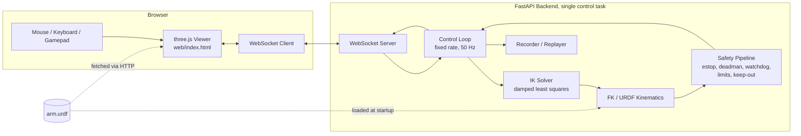

# PLAN.md

## Summary

`humanoid-arm-teleop` is a browser-based teleoperation demo for a simulated 6-DOF (6R) humanoid-style robot arm. A Python FastAPI backend runs forward and inverse kinematics against a URDF model at a fixed control rate and streams joint/end-effector state to a vanilla three.js frontend over WebSocket. The user commands the end-effector pose (mouse, keyboard, or gamepad); the backend solves IK, applies joint limits, safety envelope and keep-out checks, then publishes the result. This is a simulation only, there is no connection to real hardware.

### Positioning vs `teleop-console-demo`

The sibling repo `teleop-console-demo` is a FastAPI + WebSocket console for a simulated differential-drive rover: 2D-ish motion, deadman switch, e-stop, watchdog, rate limiting, network emulation (latency/loss sliders), record/replay, vanilla JS frontend, Python.

This repo reuses that project's layout, Makefile, Dockerfile, and CI style, but is not a copy. The new value is manipulation, not locomotion:

- 3D visualization (three.js) instead of a 2D/console view
- URDF as the single source of truth for both backend kinematics and frontend visuals
- Inverse kinematics (damped least squares) instead of simple velocity mixing
- Cartesian end-effector control with joint-limit clamping and singularity handling
- 3D keep-out zones and collision checks instead of simple geometric bounds
- Joint-space AND Cartesian-space speed limits

Safety primitives (e-stop, deadman, watchdog) are intentionally similar in spirit to `teleop-console-demo` for consistency across the portfolio, but implemented against joint/pose state instead of wheel velocities. Network emulation sliders are explicitly out of scope here to avoid duplicating that repo; this project's differentiator is purely the manipulation stack.

## Scope

In scope:
- Single simulated 6-DOF arm, URDF-defined, loaded by both backend and frontend
- Forward kinematics (FK) and damped least-squares IK
- Joint limits, Cartesian workspace envelope, static keep-out zones (spheres/boxes), simple collision checks (link capsule vs keep-out, not link-vs-link self-collision)
- Mouse drag (TransformControls gizmo), keyboard, and gamepad control of EE target pose
- E-stop, deadman switch (renewable lease), command watchdog
- Trajectory recording and replay (joint-space)
- Telemetry: joint states, EE pose, IK error/iterations, safety state
- ROS 2 style topic naming and message shapes over WebSocket (not actual ROS 2 / DDS)
- Docker, pytest, Playwright smoke test, GitHub Actions CI, README with screenshot and mermaid diagram

Out of scope (see also "Out of scope" section at the end):
- Real hardware connection of any kind
- Self-collision detection between arm links
- Dynamics/torque simulation, physics engine, gravity compensation
- Multi-arm or bimanual scenarios
- Network emulation (latency/loss) controls
- Actual ROS 2 / rclpy / DDS integration
- User accounts, persistence beyond local recording files
- Mobile/touch input
- Swept-path collision checking between consecutive steps

## Architecture



Both frontend and backend parse the same `arm.urdf` file, served as a static asset to the browser and loaded by the backend's kinematics module at startup. Two parsers can still disagree, so `/joint_states` always carries joint names, the browser applies values by joint name (never by index), all units are radians and meters in the `base_link` frame, and a test compares backend FK with the browser's rendered tool0 transform at a nonzero configuration (via the Playwright test hook).

## Stack (frozen pinned versions)

- Python 3.12 (numpy 2.5.x requires >=3.12)
- fastapi==0.159.1
- uvicorn[standard]==0.54.0
- pydantic==2.14.1
- numpy==2.5.4
- httpx==0.28.1 (required by `TestClient`)
- pytest==9.1.1
- No pytest-asyncio: tests use sync `TestClient`/`websocket_connect` plus a deterministic injectable `tick(dt)` call, never real sleeps
- No URDF-parsing third-party library (no `urchin`, it pulls scipy/trimesh/lxml/networkx/pycollada/pillow). Backend ships a restricted internal parser using stdlib `xml.etree.ElementTree`, supporting only: serial chain (no branching), `revolute` and `fixed` joints, no `mimic`. Any other joint type or branch in `arm.urdf` raises a startup error.
- Frontend: vendored copies committed to `web/vendor/` (no CDN, no bundler, no build step):
  - `three` 0.186.1: `three.module.js` plus `examples/jsm/controls/OrbitControls.js`, `examples/jsm/controls/TransformControls.js`, `examples/jsm/loaders/STLLoader.js`, `examples/jsm/loaders/ColladaLoader.js` (unused by geometry but required as static imports by urdf-loader; kept for import resolution)
  - `urdf-loader` 0.13.1: `URDFLoader.js`, `URDFClasses.js`
  - Include upstream LICENSE files for both in `web/vendor/LICENSES/`
  - `web/index.html` import map maps bare specifiers `three`, `three/examples/jsm/`, and `three/addons/` to the vendored paths above
- Builder note: run `pip install -r requirements.txt` with the pins above as-is; if pip's resolver reports a conflict, adjust the minimal offending pin and record the change and reason in a comment in `requirements.txt`, do not silently relax pins.
- Docker: `python:3.12-slim` base image. CI: Python 3.12.

## Concrete arm definition

6 revolute joints, serial chain, Z-up URDF convention (frontend scene root applies a fixed -90 deg rotation about X to present Y-up to three.js; a visible RGB axis triad is rendered at `base_link` so the Z-up to Y-up remap is visually verifiable; a test asserts that a +Z `/cmd_pose` delta moves the rendered EE gizmo in +world-up).

Link lengths (meters) are illustrative humanoid-arm proportions. All joints are revolute unless noted.

| Joint | Parent link | Child link | Origin xyz (m) | Origin rpy (rad) | Axis | Lower limit (rad) | Upper limit (rad) | Max velocity (rad/s) |
|---|---|---|---|---|---|---|---|---|
| joint_1 (shoulder_pan) | base_link | shoulder_link | 0, 0, 0.15 | 0, 0, 0 | 0, 0, 1 | -3.1416 | 3.1416 | 2.0 |
| joint_2 (shoulder_lift) | shoulder_link | upper_arm_link | 0, 0, 0.05 | 0, 0, 0 | 0, 1, 0 | -1.5708 | 1.5708 | 2.0 |
| joint_3 (elbow) | upper_arm_link | forearm_link | 0, 0, 0.30 | 0, 0, 0 | 0, 1, 0 | 0 | 2.6180 | 2.5 |
| joint_4 (wrist_roll) | forearm_link | wrist1_link | 0, 0, 0.25 | 0, 0, 0 | 0, 0, 1 | -3.1416 | 3.1416 | 3.0 |
| joint_5 (wrist_pitch) | wrist1_link | wrist2_link | 0, 0, 0.08 | 0, 0, 0 | 0, 1, 0 | -1.5708 | 1.5708 | 3.0 |
| joint_6 (wrist_yaw) | wrist2_link | wrist3_link | 0, 0, 0.06 | 0, 0, 0 | 0, 0, 1 | -3.1416 | 3.1416 | 3.0 |
| fixed_tool0 (fixed) | wrist3_link | tool0 | 0, 0, 0.05 | 0, 0, 0 | n/a | n/a | n/a | n/a |

Link geometry: each link is a URDF primitive cylinder (radius 0.04 m) spanning the joint-to-joint offset, used both for rendering and for the capsule collision model (segment endpoints = joint origins of that link, radius 0.04 m).

**Home pose** (non-singular, bent, used as the default start state and as the IK seed after reset): `q_home = [0.0, 0.6, 1.4, 0.0, 0.9, 0.0]` rad (tool0 at about x=0.496, y=0, z=0.203, reaching forward along +X). This keeps the elbow and wrist bent away from any singular fully-extended or fully-folded configuration.

**Reachable pose fixtures** (used in tests, computed by running FK on these joint vectors, not guessed):
- `q_fixture_a = [0.0, 0.6, 1.4, 0.0, 0.9, 0.0]` (= home, tool0 about (0.496, 0.000, 0.203))
- `q_fixture_b = [0.5, 0.3, 1.0, 0.8, 0.5, 0.2]` (tool0 about (0.429, 0.277, 0.565))
- `q_fixture_c = [-0.7, 0.7, 1.0, -0.3, 0.8, 1.0]` (tool0 about (0.434, -0.396, 0.302))
- `q_fixture_d = [0.0, 1.5708, 0.0, 0.0, 0.0, 0.0]` (used only for a near-singularity damping test: elbow straight, arm fully extended horizontally along +X, tool0 about (0.74, 0, 0.2))

The planner checked these with an independent FK script: home and fixtures a to d are inside the workspace envelope and collision-free against the default keep-out zones (capsule radius 0.04 m plus 0.03 m padding). The builder must keep a test asserting exactly that, so the demo never starts in a rejected state.

Test fixtures store the joint vector plus the FK-computed `tool0` pose (position + quaternion), generated once by a small script and pasted as literal expected values into `tests/fixtures/poses.json`, so tests assert against fixed numbers, not against the code under test.

## File layout

```
humanoid-arm-teleop/
  arm/
    arm.urdf                # single source of truth, primitives only
  backend/
    main.py                 # FastAPI app, lifespan-managed control task, routes
    urdf_model.py           # restricted xml.etree URDF parser -> joint tree, limits
    kinematics.py           # FK, geometric Jacobian, DLS IK solver
    safety.py               # safety pipeline: estop, deadman lease, watchdog, limits, keep-out
    control_loop.py         # fixed-rate tick(dt), orchestrates IK + safety, holds committed state
    clients.py               # control ownership (owner vs observers), per-connection lease state
    recorder.py             # record/replay trajectory files
    messages.py             # pydantic discriminated-union models for WS schema
    config.py               # rates, limits, keep-out zone definitions, tolerances
  web/
    index.html               # import map + canvas
    app.js                   # WS client, input handling, control-ownership UI, seq tracking
    viewer.js                # three.js scene setup, URDF loading, EE gizmo, axis triad
    vendor/
      three/                 # vendored three.module.js + examples/jsm subset
      urdf-loader/            # URDFLoader.js, URDFClasses.js
      LICENSES/
    style.css
  tests/
    test_urdf_model.py
    test_kinematics.py
    test_safety.py
    test_control_loop.py
    test_websocket_integration.py
    test_recorder.py
    fixtures/
      poses.json              # fixture joint vectors + FK-computed tool0 poses
      sample_trajectory.jsonl
    e2e/
      smoke.spec.ts           # Playwright smoke test
  recordings/
    .gitkeep
  docs/
    screenshot.png
  Makefile
  Dockerfile
  requirements.txt
  package.json                # Playwright devDependency only, no frontend build step
  .github/workflows/ci.yml
  README.md
  PLAN.md
  LICENSE
```

## WebSocket message schema / API

Single WebSocket endpoint: `ws://host/ws` (frontend derives `ws:` vs `wss:` from `window.location.protocol`; same-origin, no CORS). The static UI is mounted last in `main.py`, after the `/ws` and `/arm` routes are registered. Messages are JSON; a top-level `topic` field is a pydantic discriminated union tag. Every message, in both directions, carries `seq` (monotonically increasing integer, per connection) and `stamp` (server fills this on outbound using its own monotonic clock; on inbound, the server ignores any client-sent `stamp` for timing decisions and uses its own receipt time instead, client `stamp` is accepted only for display/logging). Invalid messages (wrong shape, non-finite numbers, bad `frame_id`, unknown `topic`) are rejected with a `/ws_error` reply and do not refresh any lease or watchdog state.

### Control ownership

The first connection that sends `/cmd_control_request` becomes the **owner** and may send `/cmd_pose`, `/cmd_deadman`, `/cmd_record`, `/cmd_reset`. Any other connection is an **observer**: it receives all `/joint_states`, `/ee_pose`, `/ik_status`, `/safety_state` broadcasts and may send `/cmd_estop` (estop is always accepted from anyone) but any other command from an observer is rejected with `/ws_error {"reason": "not_owner"}`. If the owner disconnects, the arm immediately enters `HOLD` (deadman lease treated as expired) and ownership is released; the next `/cmd_control_request` from any connection claims it.

### Client -> Server

**`/cmd_control_request`**: `{"topic": "/cmd_control_request", "seq": 1}`. Server replies `/cmd_control_ack` with `{"granted": true|false}`.

**`/cmd_pose`** (target EE pose, Cartesian teleop input, owner only):
```json
{
  "topic": "/cmd_pose",
  "seq": 42,
  "stamp": 1732300000.123,
  "position": {"x": 0.4, "y": 0.0, "z": 0.3},
  "orientation": {"x": 0.0, "y": 0.0, "z": 0.0, "w": 1.0},
  "frame_id": "base_link"
}
```
`orientation` must be a finite unit quaternion; the server normalizes it and rejects (with `/ws_error`) any quaternion with norm below 1e-6 or any non-finite component. `frame_id` must equal `"base_link"` or the message is rejected.

**`/cmd_deadman_heartbeat`** (owner only, sent by the client at 10 to 20 Hz continuously while the deadman input is held, independent of `/cmd_pose` rate): `{"topic": "/cmd_deadman_heartbeat", "seq": 43, "held": true}`. Each heartbeat with `held: true` renews a lease with a server-side timeout of 250 ms; the client must send `held: false` or disconnect/go silent to release it. The frontend sends `held: false` immediately on: pointer cancel/up, keyboard key-up of the deadman key, gamepad button release, gamepad disconnect, window `blur`, and `visibilitychange` to hidden.

**`/cmd_estop`** (anyone): `{"topic": "/cmd_estop", "seq": 44, "engaged": true}`.

**`/cmd_reset`** (owner only, clears a latched ESTOP or FAULT): `{"topic": "/cmd_reset", "seq": 45}`.

**`/cmd_record`** (owner only): `{"topic": "/cmd_record", "seq": 46, "action": "start" | "stop" | "replay" | "cancel_replay", "name": "traj_01"}`. `name` must match `^[a-zA-Z0-9_-]{1,64}$`.

### Server -> Client

**`/joint_states`** (every control tick, committed state only):
```json
{
  "topic": "/joint_states",
  "seq": 1001,
  "stamp": 1732300000.140,
  "name": ["joint_1", "joint_2", "joint_3", "joint_4", "joint_5", "joint_6"],
  "position": [0.1, -0.3, 0.5, 0.0, 0.2, 0.0],
  "velocity": [0.0, 0.0, 0.0, 0.0, 0.0, 0.0]
}
```

**`/ee_pose`**: same position/orientation shape as `/cmd_pose`, computed by FK from the committed joint state, never from the raw target or an unaccepted IK candidate.

**`/ik_status`**:
```json
{
  "topic": "/ik_status",
  "seq": 1001,
  "stamp": 1732300000.140,
  "converged": true,
  "iterations": 7,
  "position_error_m": 0.0008,
  "orientation_error_rad": 0.002,
  "near_singularity": false,
  "target_status": "OK"
}
```
`target_status` is one of `OK`, `UNREACHABLE` (IK did not converge within budget for the current target; arm holds last committed state, this is not a fault), `REJECTED_LIMITS`, `REJECTED_KEEPOUT`, `REJECTED_ENVELOPE`.

**`/safety_state`**:
```json
{
  "topic": "/safety_state",
  "seq": 1001,
  "stamp": 1732300000.140,
  "estop": false,
  "deadman_ok": true,
  "watchdog_ok": true,
  "mode": "RUNNING",
  "owner_connected": true,
  "replaying": false
}
```

**`/ws_error`**: `{"topic": "/ws_error", "seq": 1001, "stamp": ..., "reason": "not_owner" | "invalid_message" | "unknown_topic" | "rate_limited"}`.

All server-to-client messages share `topic`, `seq`, and `stamp`. Outbound send to a slow client never blocks the control loop: each connection has a 1-slot outbound mailbox per topic (latest-state only), overwritten if the previous value was not yet flushed; the server never queues unbounded backlog or sleeps the loop waiting on a client.

## State machine

States: `RUNNING`, `HOLD`, `ESTOP`, `FAULT`, `REPLAYING`.

Transitions (evaluated every tick, in this exact priority order, highest first):

1. `ESTOP` is latched: entered from any state the instant `/cmd_estop {"engaged": true}` is received, from anyone, regardless of owner. Exits only via `/cmd_reset` from the owner, which moves to `HOLD` (never directly to `RUNNING`).
2. `FAULT` is latched: entered from any state when the control loop detects a numerical error (non-finite joint value, non-finite Jacobian/SVD result) or 3 consecutive control-tick overruns beyond a hard budget (default 40 ms at 50 Hz; single overruns are only counted in telemetry, so a GC pause on a CI runner does not latch FAULT). An unreachable IK target is explicitly NOT a fault (see `/ik_status.target_status = UNREACHABLE`). Exits only via `/cmd_reset` from the owner, which moves to `HOLD`.
3. On any transition into `HOLD` via `/cmd_reset`: the stale target buffer is cleared and reset to the current committed FK pose (`target := current EE pose`), so there is no snap when motion resumes. The owner must re-press deadman and send a fresh `/cmd_pose` before the state machine will consider `RUNNING`.
4. `HOLD`: entered when the deadman lease has expired (no `held: true` heartbeat renewed within 250 ms) or the owning connection disconnects, or on reset as above. While in `HOLD`, the committed joint state does not move; `/cmd_pose` messages are still accepted and update the target buffer (so the operator can line up a target before re-engaging deadman) but are not applied to motion.
5. `RUNNING`: entered automatically from `HOLD` once deadman lease is active AND at least one `/cmd_pose` has been received since entering `HOLD` AND estop is not engaged AND no fault is latched. In `RUNNING`, the control loop advances the committed state toward IK solutions each tick subject to the full safety pipeline below.
6. `REPLAYING`: entered only via `/cmd_record {"action": "replay"}` from the owner, and only when the current state is `HOLD` (not `RUNNING`, not `ESTOP`, not `FAULT`). While `REPLAYING`, the deadman/watchdog checks are suspended (no live operator input expected) but `/cmd_estop` immediately halts replay and transitions to `ESTOP`. Replay ends (reaches the last recorded sample or receives `/cmd_record {"action": "cancel_replay"}`) and transitions back to `HOLD`.

## Kinematics and IK approach

**FK**: for a serial chain, each joint's transform is `T_parent_child = T_origin(xyz, rpy fixed-axis-xyz) @ T_rot(axis, q)`, where `T_origin` is a fixed 4x4 built from the URDF `origin` element (rpy applied as extrinsic fixed-axis X then Y then Z, matching URDF convention) and `T_rot` is a 4x4 pure rotation of angle `q` about the joint's `axis` (unit vector in the parent-rotated frame). The end-effector pose is the chained product through to `tool0`, including the final fixed joint. This is NOT a Denavit-Hartenberg parameterization; DH is not used anywhere in this codebase.

**Jacobian**: base-frame geometric Jacobian `J = [Jv; Jw]`, 6x6 for 6 revolute joints. For joint `i` with axis direction `z_i` (in base frame, after accumulating parent rotations) and origin position `p_i` (in base frame), and end-effector position `p_e`:
- Linear column: `Jv_i = z_i x (p_e - p_i)`
- Angular column: `Jw_i = z_i`

Computed analytically from the same chained transforms used for FK (no finite-difference Jacobian in production code; finite differences are used only in tests to check the analytic Jacobian).

**Pose error** `e` (6-vector, used both for convergence check and as the DLS right-hand side):
- Position: `e_p = p_target - p_current` (3-vector, meters)
- Orientation: `e_o = log(R_target @ R_current.T)^vee`, the `so(3)` logarithm mapped to its vector (axis * angle) form. Implementation must branch explicitly: near-zero rotation angle (`theta < 1e-6`) uses the first-order approximation `e_o ≈ 0.5 * (R[2,1]-R[1,2], R[0,2]-R[2,0], R[1,0]-R[0,1])` to avoid a 0/0 division; near-pi rotation (`theta > pi - 1e-3`) uses the stable formula via the largest diagonal element of `(R + I)` to extract the axis, avoiding the generic formula's division by `sin(theta)` blowing up.
- Before combining into one 6-vector for damping, scale `e_o` by a characteristic length `L = 0.3` (meters, roughly the arm's reach) so position (meters) and orientation (radians, after scaling by L) are unit-consistent, i.e. the solved RHS is `e = [e_p; L * e_o]` and the resulting `dq` is computed consistently; the same scaling factor `L` is applied to the corresponding rows of `J` before solving, then the scaling is undone when interpreting iteration-level error magnitudes for convergence/display (the displayed `orientation_error_rad` is the unscaled `e_o` magnitude).

**IK solver**: Damped Least Squares per iteration:
```
A = J @ J.T + (lambda**2) * I_6
dq = J.T @ numpy.linalg.solve(A, e)
```
Never compute an explicit matrix inverse; always use `numpy.linalg.solve`.

- **Adaptive damping**: each iteration, compute the SVD of `J` (`numpy.linalg.svd(J, compute_uv=False)` for singular values only). If the smallest singular value `sigma_min < 0.01`, set `lambda = 0.05 + 2.0 * (0.01 - sigma_min)`, otherwise `lambda = 0.05`. This full-SVD-per-iteration approach costs roughly 30 ms for 2500 6x6 SVDs (measured), well within the per-tick IK budget, so no cheaper approximation is needed.
- **Step bound and backtracking**: compute `dq`, then clamp `max(abs(dq)) <= 0.5` rad by uniform scaling if exceeded. Evaluate the residual norm `|e|` at `q + dq` via FK; if it is not smaller than at `q`, halve `dq` (up to 4 halvings) before accepting; if still not improved after 4 halvings, keep `q` unchanged for this iteration and increment a stall counter.
- **Joint-limit active set**: at each iteration, recompute (never cache across iterations) a per-joint active/inactive flag: a joint is inactive for this iteration only if it is currently at a bound (within 1e-6) AND the sign of its proposed `dq` component would move it further outside that bound. Inactive joints have their Jacobian column and `dq` component zeroed for that iteration only; the next iteration recomputes from scratch, so a joint can re-engage once the commanded direction reverses. Joints are never permanently zeroed.
- **Convergence criteria**: converged when `|e_p| < 0.002` m AND unscaled `|e_o| < 0.01` rad, checked after each iteration, max 50 iterations per control tick.
- **IK candidate vs committed state**: the IK solver operates on an internal `q_candidate` seeded from the current committed `q_committed` each tick. If IK converges, `q_candidate` becomes the proposed next step; it is NOT applied yet (see safety pipeline). If IK does not converge within 50 iterations, `target_status = UNREACHABLE` is published, `q_candidate` is discarded, and `q_committed` does not change this tick. This is a per-tick rejected-target condition, never a `FAULT`.

Control loop runs at a fixed rate of 50 Hz (`config.CONTROL_HZ = 50`, tick `dt = 0.02` s), decoupled from WebSocket message arrival rate. Incoming `/cmd_pose` updates only the target buffer; the loop's `tick(dt)` function is injectable and called either by a real asyncio periodic task in production or directly and synchronously by tests with a fake clock, never via `time.sleep` in tests.

## Safety pipeline (exact per-tick order)

Executed once per `tick(dt)`, in this order, each step able to short-circuit the rest:

**(a) Latched checks.** If `ESTOP` or `FAULT` is latched, skip everything else: zero velocity, hold `q_committed`, publish state, return.

**(b) Deadman lease and watchdog.** If the owner's deadman lease has expired (no `held: true` heartbeat within the last 250 ms) or there is no connected owner, force state to `HOLD`, hold `q_committed`, publish, return. This subsumes the old "command watchdog" concept: the lease itself is the single timing mechanism, renewed only by `/cmd_deadman_heartbeat`, independent of `/cmd_pose` frequency, so a stationary held target never spuriously trips HOLD.

**(c) Compute IK candidate.** Run the DLS IK solver (above) from `q_committed` toward the current target buffer, producing `q_candidate` and `target_status`. If `UNREACHABLE`, publish and return without changing `q_committed`.

**(d) Velocity-limit bounding with backtracking.** Compute `dq_raw = q_candidate - q_committed`. Scale `dq_raw` uniformly by a single factor so that no joint's `|dq/dt|` exceeds its per-joint `Max velocity (rad/s)` from the joint table. Compute FK of the resulting bounded `q_bounded` and check the implied EE linear speed (`|dp|/dt <= 1.0` m/s) and angular speed (`|d theta|/dt <= 2.0` rad/s); if either is exceeded, scale `dq_raw` down further (binary search, up to 8 iterations) until both hold. The output of this step, `q_bounded`, is the exact candidate checked in step (e); collision and limits are never checked against the original unscaled `q_candidate` or the raw target.

**(e) Limits, envelope, and collision check on `q_bounded`.**
- Joint limits: if any joint in `q_bounded` is outside `[lower, upper]`, clamp it to the bound and set `target_status = REJECTED_LIMITS` for that tick (motion still proceeds with the clamped value for the other joints).
- Workspace envelope: axis-aligned bounding box in base frame (default `x in [-0.8, 0.8]`, `y in [-0.8, 0.8]`, `z in [0.0, 1.2]`, configurable in `config.py`). If the FK of `q_bounded` places `tool0` outside this box, reject the entire step: set `target_status = REJECTED_ENVELOPE`, do not commit, `q_committed` unchanged this tick.
- Keep-out collision: model every link as a capsule (the two joint-origin endpoints of that link, radius 0.04 m, from the arm table). Check each capsule against every configured keep-out zone (sphere: center + radius; or axis-aligned box: min/max corners), both padded by a fixed clearance margin of 0.03 m. If any capsule intersects any padded zone at `q_bounded`, reject the entire step: `target_status = REJECTED_KEEPOUT`, do not commit. Collision is always checked on `q_bounded` (the actual next committed candidate), never on the raw distant target, and because per-tick motion is bounded smaller than the zone padding margin, a single tick cannot tunnel through a thin zone; multi-tick tunnelling through a zone thinner than one tick's worst-case motion is a documented, accepted limitation (see Edge cases).

**(f) Commit.** If step (e) passed without an envelope or keep-out rejection, atomically set `q_committed := q_bounded` (joint-limit clamping within (e) is allowed to proceed and commit). Publish `/joint_states`, `/ee_pose`, `/ik_status`, `/safety_state` from the new `q_committed`.

Default keep-out zones (defined in `config.py`, used by both tests and the running demo): one sphere `center=(0.30, -0.45, 0.65), radius=0.12` (an overhead obstacle within reach) and one box `min=(0.35, -0.25, 0.0), max=(0.65, 0.25, 0.08)` (a low tabletop obstacle in front of the arm). Neither zone may overlap the base link or the home pose; an earlier draft placed the box around the base, which would have rejected every step.

## Recording / replay format

Trajectories are JSON Lines (`.jsonl`) files under `recordings/`, filename restricted to `^[a-zA-Z0-9_-]{1,64}\.jsonl$`, size capped at 10 MB (recording auto-stops and the file is closed if the cap is hit). First line is a header:
```json
{"schema_version": 1, "joint_names": ["joint_1","joint_2","joint_3","joint_4","joint_5","joint_6"], "urdf_sha256": "<hex digest of arm.urdf at record time>", "tick_dt": 0.02}
```
Every subsequent line is one committed tick, with time relative to recording start (not wall-clock stamps):
```json
{"t": 0.02, "joint_position": [0.1, -0.3, 0.5, 0.0, 0.2, 0.0], "safety_mode": "RUNNING"}
```

`recorder.py` exposes `start(name)`, `stop()`, `replay(name)`, `cancel_replay()`. `replay(name)` first verifies `urdf_sha256` in the header matches the currently loaded `arm.urdf`; on mismatch it refuses with an error (not a crash). Replay requires the state machine to currently be in `HOLD`; it then becomes the exclusive controller of `q_committed` for its duration, pushing each recorded sample through the same safety pipeline steps (d) through (f) (velocity-limit bounding from the current committed state toward each recorded sample in turn, then limits/envelope/keep-out check, then commit) so replay physically cannot violate any safety constraint even if the recording predates a config change; step (a)/(b) still apply (estop still halts replay instantly; deadman/watchdog are suspended during `REPLAYING`). `/safety_state.replaying = true` for the duration. Replay moves to the first recorded sample using the normal bounded stepping (no teleport) before beginning tick-for-tick playback at `tick_dt` from the header.

## Edge cases

- Target outside reachable workspace: `target_status = UNREACHABLE`, state remains `RUNNING`/`HOLD`, `q_committed` unchanged, not a fault.
- Rapid large jumps in commanded target: step (d) velocity scaling bounds the step every tick regardless of target distance, producing smooth multi-tick convergence, never a snap.
- WebSocket disconnect of the owner mid-session: treated identically to deadman lease expiry, immediate `HOLD`, ownership released for the next claimant; a reconnecting client must re-request control and will receive current state via the next broadcast.
- A second client connects while another holds control: it is an observer, receives all telemetry, may send `/cmd_estop` only; any other command is rejected with `/ws_error {"reason": "not_owner"}`.
- Keep-out zone between current position and target along a straight line, but not at the bounded per-tick step itself: not detected, this is the documented swept-path limitation; mitigated in practice by checking every bounded per-tick step (not just the final target) and keeping per-tick motion smaller than zone padding, but a zone thinner than one tick's worst-case displacement can still be tunnelled through across ticks; this is accepted and documented, not fixed.
- Gamepad disconnected mid-use: frontend immediately sends `held: false`, causing `HOLD` within one lease timeout.
- Browser tab loses focus (`blur`) or becomes hidden (`visibilitychange`): frontend immediately sends `held: false`.
- E-stop engaged during `REPLAYING`: immediate transition to `ESTOP`, replay aborted, requires `/cmd_reset` then a fresh `/cmd_record {"action":"replay"}` to resume from the start (no mid-replay resume).
- Invalid/malformed inbound message: rejected with `/ws_error`, does not renew any lease or watchdog timer, so a flood of invalid messages cannot be used to fake a held deadman.

## Test plan

**`test_urdf_model.py`**:
- Parses `arm/arm.urdf` and produces exactly 6 revolute joints in order plus 1 fixed tool joint, matching the joint table above (names, parents, children, origins, axes, limits, velocity limits)
- Rejects a crafted URDF containing a `continuous` joint, a `prismatic` joint, a `mimic` tag, or a branching link (two children on one link) with a clear error, not a silent partial parse

**`test_kinematics.py`**:
- FK at `q = [0,0,0,0,0,0]` and at each of `q_fixture_a..d` matches the literal expected `tool0` pose stored in `tests/fixtures/poses.json`, tolerance 1e-6 m / 1e-6 rad
- Analytic Jacobian at `q_fixture_b` matches a central finite-difference Jacobian (step 1e-6), tolerance 1e-4
- IK round-trip: run FK on `q_fixture_b` to get a target pose, run IK from `q_home` as seed, assert the resulting pose error (not joint angles) is within 0.002 m / 0.01 rad; repeat for `q_fixture_c`
- Near-pi rotation: construct a target requiring a near-180-degree wrist rotation, assert `e_o` computation does not produce NaN/Inf and IK still converges
- Home and fixtures a to d are inside the envelope and collision-free against the default keep-out zones
- Damping increases at `q_fixture_d` (near-singular, fully extended): assert computed `lambda > 0.05`
- Joint-limit active set: drive a joint to its bound with a target that would push it further out, assert that joint's value never exceeds its URDF bound across 50 iterations, then assert it can move inward again once the target reverses

**`test_safety.py`** (table-driven, one parametrized test function iterating over named transition cases):
- estop engaged from RUNNING -> ESTOP; estop from HOLD -> ESTOP; reset from ESTOP -> HOLD with target cleared to current pose
- fault injection (forced non-finite joint value) -> FAULT; reset from FAULT -> HOLD
- deadman lease expiry (no heartbeat for 250ms) from RUNNING -> HOLD
- owner disconnect from RUNNING -> HOLD, ownership released
- stale/invalid `/cmd_pose` (non-finite, bad frame_id) rejected, does not renew lease, does not change `q_committed`
- replay interrupted by estop -> ESTOP, replay aborted, `replaying` false afterward
- velocity scaling then collision: a target that would be reachable unscaled but whose scaled `q_bounded` intersects a keep-out zone is rejected with `REJECTED_KEEPOUT`, `q_committed` unchanged
- link-capsule-in-zone: a `q_bounded` where a mid-link capsule (not just the EE point) intersects the table-box keep-out zone is rejected
- Every case in this file asserts the committed-state invariant after the tick: `/ee_pose` broadcast equals FK of `q_committed`, never of `q_candidate` or `q_bounded` when rejected

**`test_control_loop.py` / `test_websocket_integration.py`**:
- Full loop: owner connects, requests control, sends deadman heartbeat + `/cmd_pose`, calls `tick(dt)` repeatedly with a fake clock, asserts `/joint_states` converges toward the fixture target over successive ticks
- Observer connects second, attempts `/cmd_pose`, receives `/ws_error {"reason": "not_owner"}`
- Estop from an observer connection is accepted and halts motion
- `/safety_state.mode` transitions exactly match the state machine table above for a scripted sequence of inputs

**`test_recorder.py`**:
- Record a short scripted trajectory, stop, verify the JSONL header and line count
- Replay the recorded file, assert the sequence of committed `q` values generated during replay matches the recorded `joint_position` values exactly
- Replay with a tampered `urdf_sha256` in the header is refused with a clear error, not a crash

All numeric assertions use the explicit tolerances stated above (never bare `assert a == b` on floats). No test uses `time.sleep` or `pytest-asyncio`; all async-looking behavior is driven through the injectable `tick(dt)` and a fake monotonic clock.

**`tests/e2e/smoke.spec.ts`** (Playwright, Node/TypeScript, separate from the pytest suite):
- Launches the Docker-built (or locally run) backend, opens the page in a headless browser
- Asserts: page loads with HTTP 200, zero `console.error` events during load, the URDF-derived arm mesh (6 primitive links) is present in the three.js scene (checked via a `window.__TEST_HOOKS__` object exposed by `app.js` only when a `?test=1` query param is present), and sending a scripted keyboard input changes the reported joint state (polled via the same test hook)

## CI

`.github/workflows/ci.yml`, two jobs:

**Job 1: `pytest`**
```yaml
- actions/setup-python@v5 with python-version: "3.12"
- pip install -r requirements.txt
- pytest -q
```

**Job 2: `smoke`** (depends on nothing, runs in parallel, but gates merge alongside Job 1)
```yaml
- actions/setup-node@v4 with node-version: "20"
- npm install (installs Playwright only, per package.json)
- npx playwright install --with-deps chromium
- Start the backend: python -m uvicorn backend.main:app --host 0.0.0.0 --port 8000 &
- Wait for http://localhost:8000/ to return 200 (poll with timeout, not a fixed sleep)
- npx playwright test tests/e2e/smoke.spec.ts
```

**Job 3: `docker-smoke`**
```yaml
- docker build -t arm-teleop .
- docker run -d -p 8000:8000 arm-teleop
- Poll http://localhost:8000/ until 200 (timeout 30s)
- curl -f http://localhost:8000/arm/arm.urdf to confirm the static URDF route is served
- docker stop the container
```

All three jobs run on push and PR to `main`; all three must pass to merge.

## Docker

`Dockerfile` based on `python:3.12-slim`:
- Copy `requirements.txt`, `pip install --no-cache-dir -r requirements.txt`
- Copy `backend/`, `arm/`, `web/`
- `EXPOSE 8000`
- `CMD ["uvicorn", "backend.main:app", "--host", "0.0.0.0", "--port", "8000", "--workers", "1"]` (exactly one worker: the control loop lives in-process and is not safe to run under multiple workers)
- `Makefile` targets: `make install`, `make test`, `make run`, `make smoke` (runs the Playwright job locally), `make docker-build`, `make docker-run`, matching the sibling repo's conventions.

## README outline

1. Title + one-line pitch + screenshot
2. Honest framing banner: "Simulation demo, not connected to real hardware"
3. What this demonstrates (bullet list: URDF-driven kinematics, IK, safety pipeline, teleop, control ownership model)
4. Mermaid architecture diagram (same as above)
5. Quickstart (`make install && make run`, open browser)
6. Controls table (mouse drag gizmo axes, keyboard keys, gamepad mapping, deadman key, e-stop key, reset key)
7. WebSocket API summary (link to schema section, note control-ownership model and deadman heartbeat)
8. Safety design summary (state machine diagram and per-tick pipeline order)
9. Mapping to real hardware:
   - Replace the WebSocket `/cmd_pose` bridge with `moveit_servo` (or a direct MoveIt 2 motion-planning pipeline) consuming Cartesian twist/pose targets
   - Downstream of planning, motion goes through `ros2_controllers` (joint trajectory controller or forward command controller) to a `ros2_control` hardware interface talking to real joint controllers
   - Swap the demo's DLS IK solver for a MoveIt 2 kinematics plugin (KDL or TRAC-IK)
   - Replace static keep-out zones with MoveIt 2 planning scene collision objects and real sensor-based octomaps
   - Replace software deadman/e-stop with real hardware safety-rated I/O (dual-channel e-stop circuits), a separate layer from this demo's software simulation
10. Running tests (pytest, Playwright smoke, Docker smoke)
11. License

## Milestones

**M1 (must ship, core demo):**
- `arm/arm.urdf` and restricted URDF parser (`urdf_model.py`)
- FK, Jacobian, DLS IK solver (`kinematics.py`)
- Full safety pipeline and state machine (`safety.py`, `control_loop.py`)
- WebSocket schema, control ownership, deadman heartbeat (`messages.py`, `clients.py`, `main.py`)
- Keyboard control of EE target from the frontend
- three.js 3D view rendering the URDF arm with axis triad
- `test_urdf_model.py`, `test_kinematics.py`, `test_safety.py`, `test_control_loop.py`, `test_websocket_integration.py`
- `pytest` CI job green

**M2 (must ship, polish and portfolio presentation):**
- Mouse `TransformControls` gizmo for EE target dragging
- Gamepad input mapping
- Record/replay (`recorder.py`, `test_recorder.py`)
- Docker image and `docker-smoke` CI job
- Playwright `smoke.spec.ts` and `smoke` CI job
- README with real screenshot, mermaid diagram, controls table, hardware-mapping section
- `make` targets complete and matching sibling repo conventions

Both milestones are required for the project to be considered complete; there is no separate "stretch" tier.

## Success criteria

1. `make install && pytest -q` passes with zero failures on a clean checkout
2. `make run` serves the frontend and WebSocket backend; opening the browser shows a rendered 3D arm matching `arm.urdf`'s joint table, with a visible axis triad confirming correct Z-up to Y-up orientation
3. Requesting control, holding the deadman key, and dragging the EE target (mouse gizmo, keyboard, or gamepad) moves the arm smoothly, converging IK within 0.002 m / 0.01 rad, visible in both the 3D view and `/joint_states`/`/ee_pose` telemetry
4. Releasing the deadman key/button, disconnecting a gamepad, blurring the tab, or hiding the tab immediately transitions to `HOLD` within one lease timeout (250 ms), visible in `/safety_state.mode == "HOLD"`
5. Engaging e-stop from any connection (owner or observer) halts all motion within one control tick, transitions to `ESTOP`, and requires an explicit owner `/cmd_reset` to return to `HOLD` with the target cleared to the current pose (no snap)
6. Loss of the deadman heartbeat for more than 250 ms results in `HOLD` automatically, independent of `/cmd_pose` message rate
7. Commanding a target whose bounded per-tick step would intersect a configured keep-out zone is rejected (`REJECTED_KEEPOUT`) and the arm does not move into the zone
8. Commanding an unreachable target yields `target_status = UNREACHABLE` without entering `FAULT` and without producing an out-of-joint-limit committed position; a forced numerical error correctly enters `FAULT` and requires `/cmd_reset`
9. A recorded trajectory, when replayed, reproduces the exact same committed joint positions, subject to the same safety pipeline, and is itself interruptible by e-stop
10. A second connecting client is treated as a read-only observer (can e-stop, cannot command or reset) until the owner disconnects
11. `pytest`, Playwright `smoke`, and `docker-smoke` CI jobs all pass on GitHub Actions on a fresh clone with no local-only dependencies
12. Docker image builds with exactly one uvicorn worker and serves both the backend and the static frontend and URDF correctly
13. README includes an honest "simulation only" framing, a real screenshot, a mermaid diagram, a controls table, and a "Mapping to real hardware" section correctly naming `moveit_servo`, `ros2_controllers`, `ros2_control`, and a MoveIt 2 kinematics plugin (KDL or TRAC-IK) for IK
14. Both M1 and M2 milestones are complete

## Out of scope

- Any real hardware connection, serial/CAN/EtherCAT drivers, or physical safety circuits
- Self-collision detection between arm links (only link-capsule-vs-keep-out is checked)
- Full physics/dynamics simulation (no gravity, torque, or contact forces)
- Swept-path (continuous) collision checking between consecutive committed steps; only each bounded per-tick step is checked, with a documented tunnelling limitation for zones thinner than one tick's worst-case motion
- Multi-client simultaneous control; only single-owner control plus read-only observers is supported
- Network latency/packet-loss emulation (that is the sibling repo's feature)
- Mobile or touch-based control schemes
- User authentication, persistent accounts, or cloud storage of recordings
- Actual ROS 2 / DDS transport; topic names and message shapes are ROS-like for familiarity only
- Running more than one uvicorn worker or any multi-process/multi-instance deployment of the control loop
