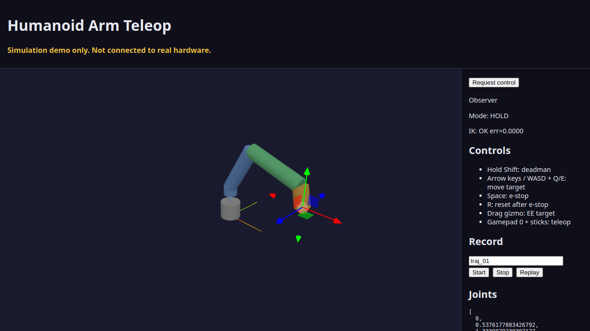
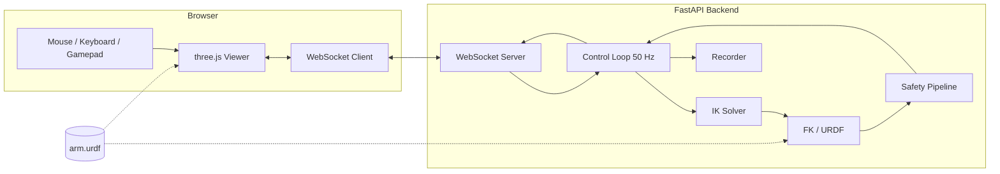

# Humanoid Arm Teleop

[](https://github.com/applycoding/humanoid-arm-teleop/actions/workflows/ci.yml)

Browser teleoperation for a simulated 6-DOF humanoid-style arm: URDF-driven kinematics, damped least-squares IK, safety envelope, and a three.js 3D view.



## Simulation demo, not connected to real hardware

This project is a **simulation demo** only. It runs entirely in Python and the browser. There is no serial bus, no real-time controller, and no physical robot. Software e-stop and deadman patterns illustrate design ideas; they are not substitutes for rated safety hardware on a real system.

## What this demonstrates

- Single URDF model shared by backend FK/IK and frontend rendering
- Cartesian end-effector teleop with joint limits and velocity bounds
- Damped least-squares IK with singularity-aware damping
- Keep-out zones (sphere and box) with link capsule checks
- WebSocket API with ROS-like topic names, single-owner control, and observers
- Trajectory record and replay in joint space
- E-stop, deadman lease, and latched fault handling

## Architecture



## Quickstart

```sh
make install
make run
```

Open http://localhost:8000

## Controls

| Input | Action |
| --- | --- |
| Request control (button) | Become operator (first claim wins) |
| Hold Shift | Deadman (required for motion) |
| Arrow keys / WASD, Q/E | Move end-effector target while deadman held |
| Drag translate gizmo | Move target in 3D |
| Space | Emergency stop (any connection) |
| R | Reset after e-stop or fault (owner only) |
| Gamepad button 0 + left stick | Deadman + target motion |
| Record panel | Start/stop/replay named trajectories |

## WebSocket API

Endpoint: `ws://<host>/ws` (or `wss://` on HTTPS).

The first client that sends `/cmd_control_request` becomes the **owner** and may send `/cmd_pose`, `/cmd_deadman_heartbeat`, `/cmd_record`, and `/cmd_reset`. Other clients are **observers**: they receive telemetry and may send `/cmd_estop` only.

Owner must send `/cmd_deadman_heartbeat` with `held: true` at 10 to 20 Hz while operating. Lease timeout is 250 ms.

See `PLAN.md` for the full message schema.

## Safety design

States: `RUNNING`, `HOLD`, `ESTOP`, `FAULT`, `REPLAYING`.

Per control tick (50 Hz), after latched e-stop/fault and deadman checks:

1. Solve IK toward the target buffer
2. Velocity-limit the joint step and end-effector speeds
3. Check joint limits, workspace envelope, and keep-out capsules
4. Commit or reject the bounded step

## Mapping to real hardware

On a physical humanoid arm you would typically:

- Replace the WebSocket `/cmd_pose` bridge with **moveit_servo** (or a MoveIt 2 pipeline) consuming Cartesian targets
- Send planned motion through **ros2_controllers** into a **ros2_control** hardware interface
- Swap this demo IK for a MoveIt 2 kinematics plugin such as **KDL** or **TRAC-IK**
- Replace static keep-out zones with MoveIt planning-scene objects and sensor-driven maps
- Wire hardware-rated e-stop and deadman I/O outside this simulation stack

## Running tests

```sh
make test
make smoke
make docker-build
```

- `pytest` covers URDF parsing, FK/IK, safety, control loop, WebSocket rules, and recorder
- Playwright `tests/e2e/smoke.spec.ts` checks the 3D page and a keyboard-driven joint update
- Docker smoke is exercised in CI (`docker-smoke` job)

## License

MIT. See [LICENSE](LICENSE).
